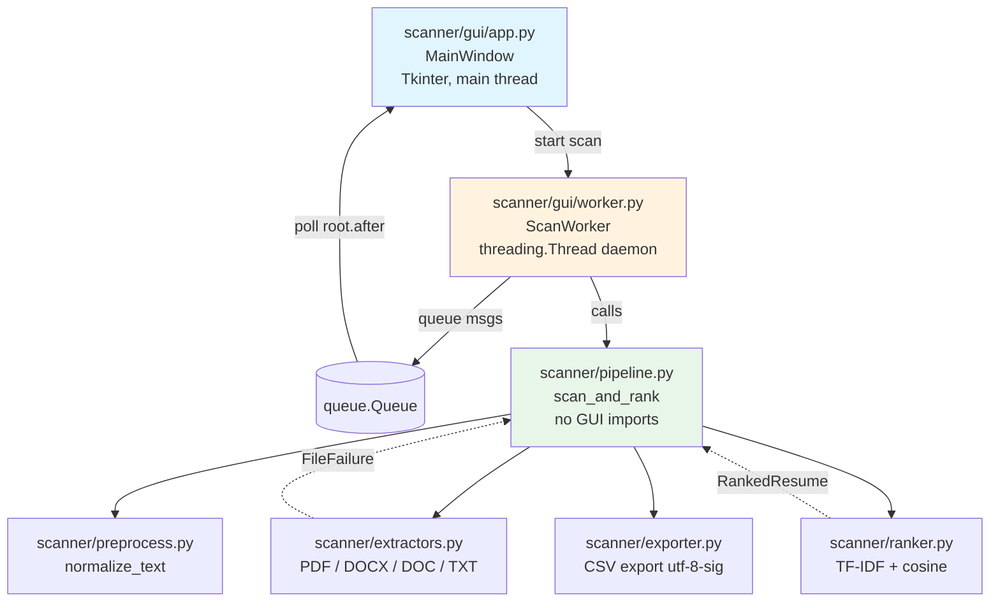

# Project Report Notes — Resume Scanner & Ranker

Bullet material for the BCA final-year project report. Copy/adapt into your report as needed.

---

## 1. Architecture diagram (Mermaid)



Rule: arrows only point downward. `scanner/` outside `gui/` never imports `tkinter`.

---

## 2. Algorithm flow

1. Recruiter pastes a JD and adds resume files (PDF / DOCX / DOC / TXT).
2. Click **Scan & Rank** → GUI validates JD (non-trivial keywords) and ≥1 resume.
3. `ScanWorker` (background thread) calls `pipeline.scan_and_rank()`.
4. Pipeline extracts text from each file **sequentially** (PyMuPDF is not thread-safe).
   - One bad file → `FileFailure` with a readable reason; scan continues.
   - Progress posted per file via `on_progress`.
   - `Cancel` sets a `threading.Event` checked before each file.
5. Extracted resumes are normalized (`normalize_text`): NFKC, lower-case, URL/email/phone removal, tech-token map (`c++`→`cplusplus`, `.net`→`dotnet`, etc.), punctuation stripping, synonym expansion (`ml`→`machine learning`), standalone-number removal, whitespace collapse.
6. `TfidfVectorizer` (stop words, ngram range (1,2), sublinear TF) is fit on `[jd, *resumes]` together.
7. Cosine similarity (`sklearn cosine_similarity`) between the JD vector and each resume vector.
8. Sort descending by score, tie-break by filename (lower-case). Ranks 1..N.
9. Match % = score × 100 (1 dp). Level from `LEVEL_THRESHOLDS` (Excellent ≥40, Good ≥25, Fair ≥12, else Low).
10. Top terms per resume from `jd_vec * resume_vec` element-wise product (up to 8 terms).
11. Results shown in the GUI; CSV export via `exporter.export_csv` (UTF-8 BOM for Excel).

---

## 3. sklearn smoothed-IDF note

scikit-learn's `TfidfVectorizer` uses smoothed IDF:

```
idf(t) = ln((1 + n) / (1 + df(t))) + 1
```

and L2-normalizes each row, so cosine similarity equals the dot product of the two normalized vectors. This differs slightly from the textbook TF-IDF formula in the synopsis. Mention this in the report.

---

## 4. Module list

| Module | Purpose |
|--------|---------|
| `scanner/config.py` | All thresholds, limits, stop words, token maps (single source of truth) |
| `scanner/errors.py` | Custom exception hierarchy (all subclass `ScannerError`) |
| `scanner/models.py` | Immutable data models (`ExtractedResume`, `FileFailure`, `RankedResume`, `ScanReport`, `MatchLevel`) |
| `scanner/logging_setup.py` | Rotating file + console logging; filenames/counts only, never resume text |
| `scanner/extractors.py` | Text extraction for PDF/DOCX/DOC/TXT with per-file error handling |
| `scanner/preprocess.py` | `normalize_text` 7-step cleaning pipeline (idempotent) |
| `scanner/ranker.py` | TF-IDF vectorization, cosine similarity, ranking, top terms, levels |
| `scanner/pipeline.py` | `scan_and_rank`: validate JD, de-dupe, extract, collect failures, rank |
| `scanner/exporter.py` | CSV export (`utf-8-sig`, `newline=""`) |
| `scanner/gui/app.py` | `MainWindow`: widgets, polling, button states, export, sort, close |
| `scanner/gui/worker.py` | `ScanWorker` thread + queue message dataclasses |
| `scripts/evaluate.py` | Spearman ρ, Precision@5, random + keyword-overlap baselines, `--sweep` |
| `run.py` | Entry point: `setup_logging()` → `Tk` → `MainWindow` → `mainloop()` |

---

## 5. Test summary

| Test file | What it covers |
|-----------|----------------|
| `tests/test_smoke.py` | Core modules import cleanly |
| `tests/test_architecture.py` | No `tkinter` import outside `scanner/gui/` |
| `tests/test_extractors.py` | txt encodings, docx body+tables, pdf, empty pdf, unsupported ext, missing file, oversize, corrupt pdf, `.doc` without soffice |
| `tests/test_preprocess.py` | tech tokens, URL/email/phone removal, standalone numbers vs `python3`, synonyms, idempotence, empty input |
| `tests/test_ranker.py` | relevant outranks irrelevant, identical ≥99%, deterministic, tie→filename, stop-word JD error, single resume, level boundaries, top terms |
| `tests/test_pipeline.py` | bad file in failures, all bad→empty ranked, cancel, progress N times, duplicates collapsed, empty JD error |
| `tests/test_exporter.py` | UTF-8 BOM, header, row count |
| `tests/test_evaluate.py` | keyword overlap, deterministic random, keyword-overlap ranking, system ranking, spearman ρ (perfect/inverse/nan), precision@5, label loading |

Run with: `pytest -q`

---

## 6. Evaluation results (fill in by hand)

| JD | Method | Spearman ρ | Precision@5 | Notes |
|----|--------|------------|-------------|-------|
| data_analyst | System (TF-IDF + cosine) | | | |
| data_analyst | Random (seed=42) | | | |
| data_analyst | Keyword overlap | | | |
| ml_engineer | System (TF-IDF + cosine) | | | |
| ml_engineer | Random (seed=42) | | | |
| ml_engineer | Keyword overlap | | | |
| web_developer | System (TF-IDF + cosine) | | | |
| web_developer | Random (seed=42) | | | |
| web_developer | Keyword overlap | | | |

**Baselines to beat:** random order (seeded) and raw keyword-overlap count.  
**Metrics:** Spearman ρ (system score vs human label) and Precision@5 (grade ≥ 2 = relevant).

---

## 7. Limitations and risks

- Keyword matching has no semantics ("ML" vs "machine learning", synonyms missed).
- Keyword stuffing can inflate scores — human review required.
- Tiny corpus makes IDF noisy — fit on JD + resumes together.
- Scanned PDFs / odd layouts → skipped, never scored 0%.
- `.doc` needs LibreOffice — otherwise clear message to convert to `.docx`.
- Bias proxies (college, location) possible — human decides.
- Not a hiring decision tool; output is a ranking aid.

---

## 8. Future work (outside synopsis, do not build in v1)

OCR for scanned PDFs, sentence embeddings / semantic matching, skill taxonomy, resume section parsing, web UI, saved history, bias auditing, multi-language resumes. Add ideas here, not in code.
